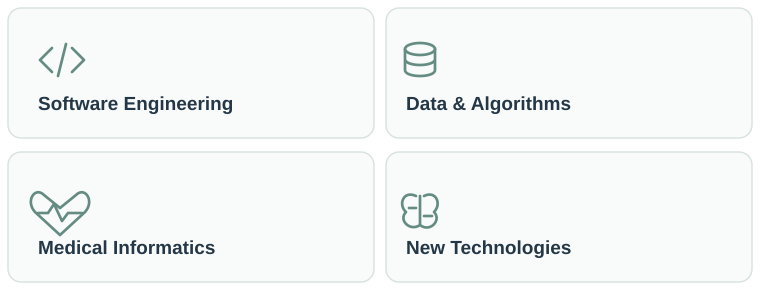

# Hi, I'm Luisa ✳

**Medical Informatics Student · University of Lübeck**

`Computer Science` · `Healthcare IT` · `Software Development`

---

### 01 / Über mich · About me

Ich studiere Medizinische Informatik an der Universität zu Lübeck. Besonders interessiert mich die Verbindung von Medizin und Informatik, wie digitale Technologien, Datenverarbeitung und Softwareentwicklung dazu beitragen können, das Gesundheitswesen weiterzuentwickeln.

*I'm studying Medical Informatics at the University of Lübeck. I'm particularly interested in how software development, data and digital technologies can contribute to advancing healthcare.*

### 02 / Was mich interessiert · My interests

### 03 / Projekte · Projects

My portfolio is currently growing. Here I'll share projects, experiments and what I learn along the way.

---

*Learning. Building. Improving.*
  
